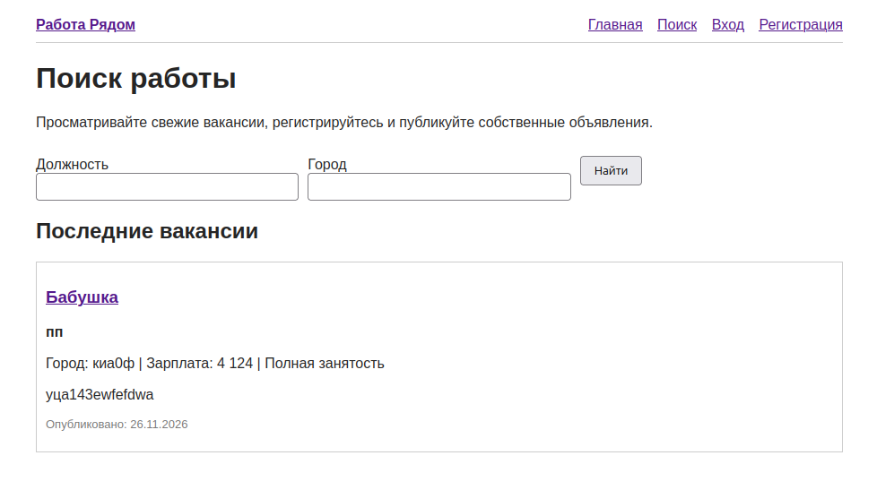
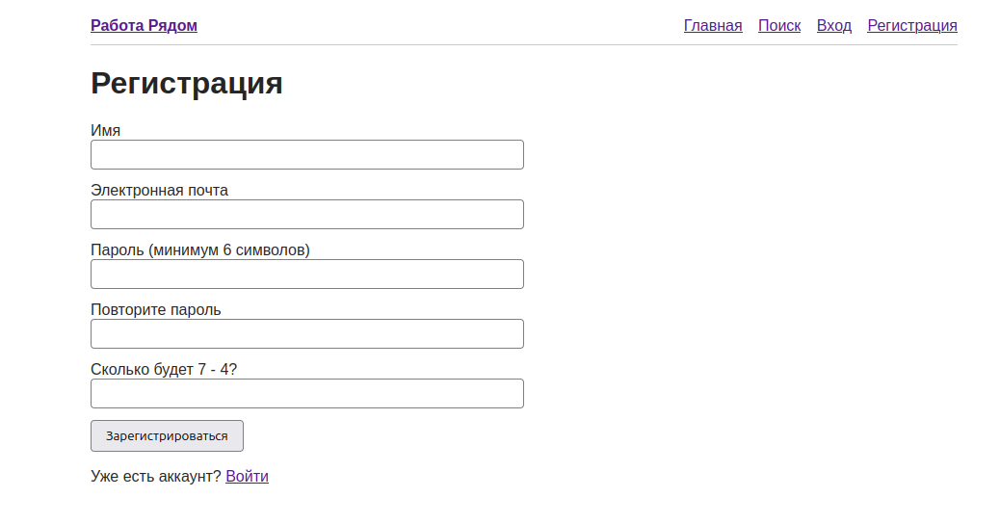
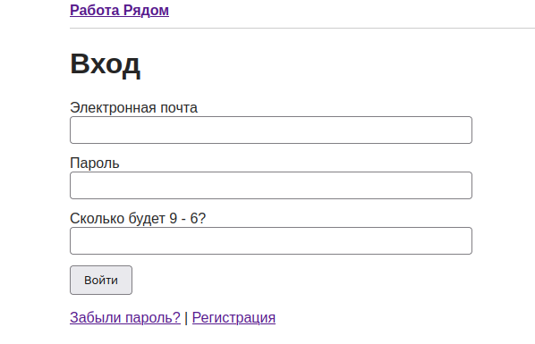
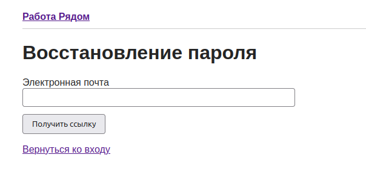
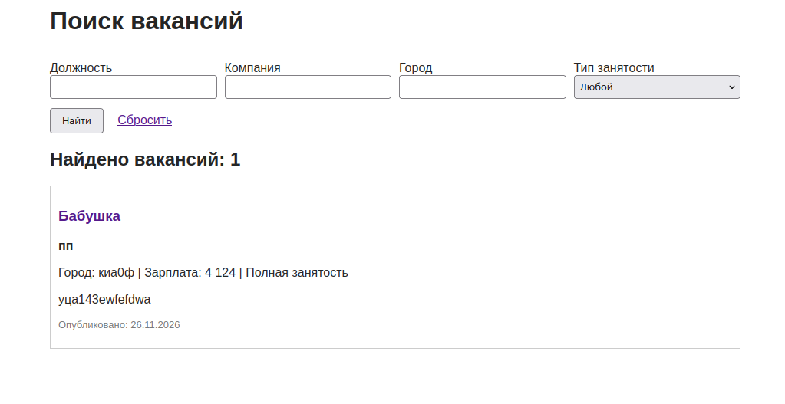
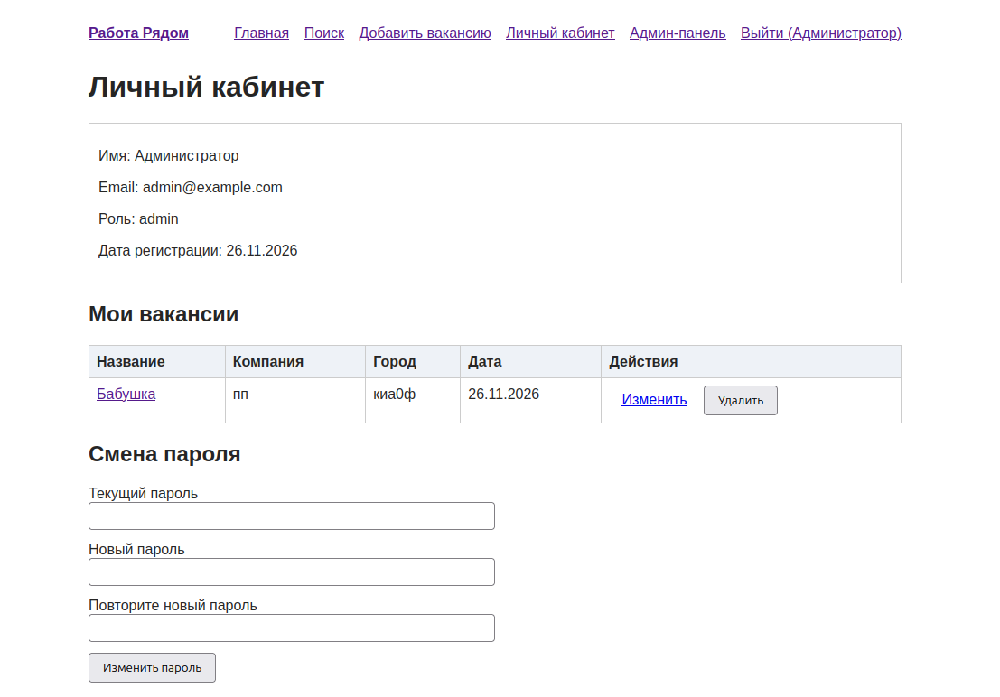
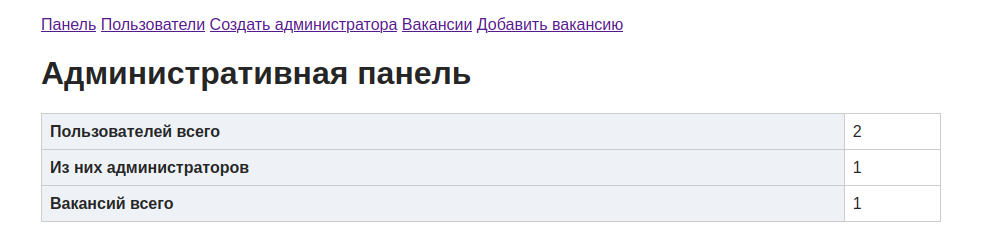

# Работа Рядом — веб-приложение для поиска работы

Индивидуальная работа по веб-разработке. Стек: PHP 8.3, SQLite, HTML, CSS, JavaScript (без фреймворков и Composer).
**Выполнил:** Гуцу Андрей
**Группа:** IA2503
**Проверил** B.Vinseschi


## Содержание

1. [Введение](#введение)
2. [Цель работы](#цель-работы)
3. [Постановка задачи](#постановка-задачи)
4. [Используемые технологии](#используемые-технологии)
5. [Описание проекта](#описание-проекта)
6. [Функциональные возможности](#функциональные-возможности)
7. [Регистрация и авторизация](#регистрация-и-авторизация)
8. [CAPTCHA](#captcha)
9. [Восстановление пароля](#восстановление-пароля)
10. [Работа с вакансиями](#работа-с-вакансиями)
11. [Поиск вакансий](#поиск-вакансий)
12. [Личный кабинет](#личный-кабинет)
13. [Административная панель](#административная-панель)
14. [Структура базы данных](#структура-базы-данных)
15. [Структура файлов проекта](#структура-файлов-проекта)
16. [Сценарии взаимодействия](#сценарии-взаимодействия-пользователя-с-приложением)
17. [Основные меры безопасности](#основные-меры-безопасности)
18. [Примеры реализации](#примеры-реализации)
19. [Инструкция по установке и запуску](#инструкция-по-установке-и-запуску)
20. [Демонстрационные учетные записи](#демонстрационные-учетные-записи)
21. [Результаты работы](#результаты-работы)
22. [Вывод](#вывод)
23. [Ответы на контрольные вопросы](#ответы-на-контрольные-вопросы)
24. [Использованные источники](#использованные-источники)

## Введение

Поиск работы сегодня почти полностью перешел в интернет. Сайты с вакансиями помогают работодателям быстро публиковать объявления, а соискателям — находить подходящие предложения. В этой работе создано простое веб-приложение «Работа Рядом», в котором можно смотреть вакансии, регистрироваться, добавлять свои объявления и искать работу по фильтрам. Вся логика выполняется на стороне сервера на PHP, данные хранятся в SQLite.

## Цель работы

Получить практические навыки разработки серверного веб-приложения на PHP: работа с базой данных, формы, аутентификация, роли пользователей, защита от типичных атак и документирование кода.

## Постановка задачи

Нужно разработать веб-приложение средней сложности, которое содержит:

- регистрацию и вход с хешированием паролей;
- восстановление пароля (дополнительное задание);
- общедоступный раздел с данными из базы;
- форму создания ресурса (не менее 5 полей) с проверкой на клиенте и сервере;
- форму поиска;
- защищенный раздел с ролью «администратор» и управлением данными;
- защиту от SQL Injection, XSS, CSRF;
- простую математическую CAPTCHA;
- код с PHPDoc и README-отчет.

Основные этапы: проектирование базы данных → создание общих файлов → страницы пользователей → администратор → безопасность → документация.

## Используемые технологии

| Технология | Для чего используется |
|---|---|
| PHP 8.3 | серверная логика, сессии, работа с БД |
| SQLite + PDO | хранение данных, база создается автоматически |
| HTML | разметка страниц и форм |
| CSS | простой внешний вид (`assets/style.css`) |
| JavaScript | клиентская проверка формы, подтверждение удаления (`assets/script.js`) |

## Описание проекта

Приложение состоит из отдельных PHP-страниц, которые подключают общие файлы из папки `includes/` через `require_once`. Шапка и подвал вынесены в `header.php` и `footer.php`, форма вакансии — в `job_form.php` (она используется на трех страницах). При первом обращении к базе функция `getDb()` создает файл `database/database.sqlite`, таблицы, администратора, демо-пользователя и четыре тестовые вакансии.

## Функциональные возможности

- Просмотр вакансий без входа (главная страница, страница вакансии).
- Регистрация, вход, выход, роли `user` и `admin`.
- CAPTCHA при регистрации и входе.
- Восстановление пароля через одноразовую ссылку (учебный режим).
- Создание, редактирование и удаление собственных вакансий.
- Поиск по должности, компании, городу и типу занятости.
- Личный кабинет со сменой пароля.
- Административная панель: пользователи, создание администраторов, полное управление вакансиями.


## Регистрация и авторизация

**Регистрация** (`register.php`): пользователь вводит имя, email, пароль, повтор пароля и ответ на CAPTCHA. PHP проверяет формат email, длину пароля, совпадение паролей, CAPTCHA и то, что email еще не занят. Пароль сохраняется только в виде хеша `password_hash()`. Новый пользователь получает роль `user`.

**Вход** (`login.php`): по email и паролю. Пользователь ищется в базе подготовленным запросом, пароль проверяется через `password_verify()`. При успешном входе вызывается `session_regenerate_id(true)` и в сессию записываются `user_id`, `user_name` и `user_role` (функция `loginUser()` в `includes/auth.php`). При ошибке показывается одно общее сообщение «Неверный email или пароль», чтобы нельзя было узнать, какие email зарегистрированы.

**Выход** (`logout.php`): очищает `$_SESSION` и вызывает `session_destroy()`.

**Защита страниц**: функция `requireLogin()` перенаправляет неавторизованных на страницу входа, `requireAdmin()` дополнительно проверяет роль.


## CAPTCHA

Дополнительное задание. Используется простой математический пример вида «Сколько будет 5 + 3?».

1. При открытии формы функция `makeCaptcha()` случайно выбирает числа и действие (сложение или вычитание) и сохраняет правильный ответ в `$_SESSION['captcha_answer']`. Пользователю показывается только текст вопроса.
2. При отправке формы функция `checkCaptcha()` сравнивает ответ с тем, что лежит в сессии. Проверка выполняется в PHP, поэтому обойти ее отключением JavaScript нельзя.
3. Ответ из сессии удаляется сразу после проверки, поэтому его нельзя использовать повторно. После каждой отправки формы создается новый пример.

CAPTCHA стоит на страницах `register.php` и `login.php`.



## Восстановление пароля

Дополнительное задание. Реализована учебная версия без отправки почты.

1. На странице входа пользователь нажимает «Забыли пароль?» и вводит email (`forgot_password.php`).
2. PHP ищет пользователя. Если он найден, создается случайный токен `bin2hex(random_bytes(32))`.
3. В таблицу `password_resets` записывается **хеш токена** (SHA-256) и время окончания действия (30 минут). Сам токен в базе не хранится. Старые токены этого пользователя удаляются.
4. Ссылка вида `reset_password.php?token=...` показывается на странице. Так сделано только для демонстрации (`DEMO_MODE` в `includes/config.php`). В реальном проекте ее отправляли бы на почту.
5. Страница `reset_password.php` находит токен по хешу и проверяет срок действия. Если все верно, пользователь вводит новый пароль, который сохраняется через `password_hash()`.
6. После смены пароля все токены пользователя удаляются, поэтому ссылка перестает работать.

Сообщение на странице всегда одинаковое («Если аккаунт с таким email существует…»), то есть форма не раскрывает, есть ли такой аккаунт. Ссылка в учебном режиме показывается только для существующего email; в реальной версии (`DEMO_MODE = false`) ссылка не показывается вообще.


## Работа с вакансиями

Вакансия содержит: название, компанию, город, зарплату, тип занятости (полная, частичная, удаленная), описание и контактный email.

- Создание: `create_job.php` (только для вошедших пользователей). Владельцем автоматически становится текущий пользователь (`currentUserId()`).
- Просмотр: `job.php?id=...`.
- Редактирование: `edit_job.php?id=...`, удаление: `delete_job.php`. Оба действия проверяют, что вакансия принадлежит текущему пользователю.

Форма создания содержит поля разных типов: `text`, `number`, `select`, `textarea`, `email`. Проверка выполняется дважды:

- на клиенте — атрибуты HTML (`required`, `min`, `maxlength`, `type="email"`) и скрипт `assets/script.js`, который показывает ошибки рядом с полями;
- на сервере — функция `validateJob()` в `includes/functions.php`. Ошибки выводятся под полями формы, а после сохранения показывается сообщение об успехе.

## Поиск вакансий

Страница `search.php` — отдельная форма с методом GET. Поля: должность, компания, город, тип занятости. Заполненные поля добавляются в SQL-запрос условиями `LIKE` или `=`, а значения передаются через `?` (подготовленный запрос). Кнопка «Сбросить» открывает страницу без параметров.

## Личный кабинет

Страница `profile.php` показывает данные пользователя (имя, email, роль, дата регистрации), таблицу его вакансий с кнопками «Изменить» и «Удалить» и форму смены пароля. Для смены пароля нужно ввести текущий пароль и дважды новый.

## Административная панель

Папка `admin/`. Каждая страница начинается с `requireAdmin()`, которая проверяет вход и **читает роль из базы данных**. Обычный пользователь при попытке открыть URL получает сообщение и перенаправляется на главную.

| Страница | Функция |
|---|---|
| `admin/index.php` | статистика: число пользователей, администраторов, вакансий |
| `admin/users.php` | просмотр всех пользователей |
| `admin/delete_user.php` | удаление пользователей (вместе с их вакансиями) |
| `admin/create_admin.php` | создание нового администратора |
| `admin/jobs.php` | просмотр всех вакансий |
| `admin/add_job.php` | добавление вакансии |
| `admin/edit_job.php` | редактирование любой вакансии |
| `admin/delete_job.php` | удаление любой вакансии |

Администратор не может удалить собственный аккаунт (в списке вместо кнопки написано «это вы», а `delete_user.php` дополнительно проверяет это на сервере). Изменения собственной роли в приложении нет, поэтому понизить свою роль нельзя.

## Структура базы данных

Файл `database/database.sqlite` создается автоматически функцией `createTables()` в `includes/database.php`.

**users** — пользователи

| Поле | Тип | Описание |
|---|---|---|
| id | INTEGER, PRIMARY KEY | идентификатор |
| name | TEXT | имя |
| email | TEXT, UNIQUE | электронная почта (логин) |
| password | TEXT | хеш пароля |
| role | TEXT | `user` или `admin` |
| created_at | TEXT | дата регистрации |

**jobs** — вакансии

| Поле | Тип | Описание |
|---|---|---|
| id | INTEGER, PRIMARY KEY | идентификатор |
| user_id | INTEGER, FOREIGN KEY → users.id | владелец вакансии |
| title | TEXT | название |
| company | TEXT | компания |
| city | TEXT | город |
| salary | INTEGER | зарплата |
| employment_type | TEXT | `full`, `part` или `remote` |
| description | TEXT | описание |
| contact_email | TEXT | контактный email |
| created_at | TEXT | дата публикации |

**password_resets** — токены восстановления пароля

| Поле | Тип | Описание |
|---|---|---|
| id | INTEGER, PRIMARY KEY | идентификатор |
| user_id | INTEGER, FOREIGN KEY → users.id | пользователь |
| token | TEXT | SHA-256 хеш токена |
| expires_at | TEXT | время окончания действия |

Связи: один пользователь → много вакансий; один пользователь → много токенов. Внешние ключи имеют `ON DELETE CASCADE`: при удалении пользователя его вакансии и токены удаляются автоматически (для этого включено `PRAGMA foreign_keys = ON`).

## Структура файлов проекта

```text
job_search/
├── index.php             главная (последние вакансии)
├── login.php             вход
├── register.php          регистрация
├── logout.php            выход
├── forgot_password.php   запрос восстановления пароля
├── reset_password.php    установка нового пароля
├── create_job.php        создание вакансии
├── search.php            поиск вакансий
├── job.php               страница вакансии
├── profile.php           личный кабинет
├── edit_job.php          редактирование своей вакансии
├── delete_job.php        удаление своей вакансии
├── admin/
│   ├── index.php         главная админ-панели
│   ├── users.php         список пользователей
│   ├── delete_user.php   удаление пользователя
│   ├── create_admin.php  создание администратора
│   ├── jobs.php          список всех вакансий
│   ├── add_job.php       добавление вакансии
│   ├── edit_job.php      редактирование вакансии
│   └── delete_job.php    удаление вакансии
├── includes/
│   ├── config.php        настройки, session_start()
│   ├── database.php      PDO, создание таблиц и начальных данных
│   ├── functions.php     общие функции (e, CSRF, CAPTCHA, валидация)
│   ├── auth.php          проверка входа и ролей
│   ├── header.php        шапка и меню
│   ├── footer.php        подвал
│   ├── job_form.php      общая форма вакансии
│   └── admin_menu.php    меню администратора
├── assets/
│   ├── style.css
│   └── script.js
├── database/
│   └── database.sqlite   создается автоматически
└── README.md
```

## Сценарии взаимодействия пользователя с приложением

**Гость.** Открывает главную → видит последние вакансии → открывает вакансию → пользуется поиском. Для создания вакансии его перенаправляют на страницу входа.

**Новый пользователь.** Регистрация (с CAPTCHA) → вход → «Добавить вакансию» → заполнение формы → сообщение об успехе → вакансия появляется в личном кабинете и на главной.

**Владелец вакансии.** Личный кабинет → «Изменить» → правка формы → сохранение. Или «Удалить» → подтверждение → вакансия удалена.

**Забыл пароль.** «Забыли пароль?» → ввод email → переход по ссылке → новый пароль → вход.

**Администратор.** Вход → «Админ-панель» → просмотр пользователей → создание нового администратора → управление любыми вакансиями → удаление пользователя при необходимости.

## Основные меры безопасности

| Угроза | Как решено |
|---|---|
| Хранение паролей | `password_hash()` и `password_verify()` |
| SQL Injection | PDO и подготовленные запросы везде, значения только через `?` |
| XSS | весь пользовательский текст выводится через функцию `e()` (`htmlspecialchars`) |
| CSRF | скрытое поле с токеном в каждой POST-форме, проверка `checkCsrf()` |
| Обход входа | проверка сессии (`requireLogin()`), `session_regenerate_id(true)` после входа |
| Доступ к админке | `requireAdmin()` на каждой странице `admin/`, роль читается из БД |
| Чужие вакансии | в запросах `UPDATE` и `DELETE` есть условие `user_id = ?`, плюс проверка в `edit_job.php` |
| Удаление по ссылке | удаление выполняется только методом POST с CSRF-токеном |
| Перебор / боты | математическая CAPTCHA на входе и регистрации |
| Перечисление email | одинаковые сообщения при входе и восстановлении пароля |
| Утечка файла БД | `database/.htaccess` запрещает доступ при Apache |

## Примеры реализации

**Подключение к SQLite и создание базы (`includes/database.php`)**

```php
$pdo = new PDO('sqlite:' . DB_PATH);
$pdo->setAttribute(PDO::ATTR_ERRMODE, PDO::ERRMODE_EXCEPTION);
$pdo->setAttribute(PDO::ATTR_DEFAULT_FETCH_MODE, PDO::FETCH_ASSOC);
$pdo->exec('PRAGMA foreign_keys = ON');

createTables($pdo);
addStartData($pdo);
```

При первом запуске SQLite сам создает файл базы, а функции создают таблицы и добавляют начальные данные.

**Вход пользователя (`login.php`)**

```php
$stmt = getDb()->prepare('SELECT * FROM users WHERE email = ?');
$stmt->execute([$email]);
$user = $stmt->fetch();

if ($user && password_verify($password, $user['password'])) {
    loginUser($user);
    setFlash('success', 'Вы успешно вошли в аккаунт.');
    redirect('index.php');
}
```

Запрос подготовленный, поэтому email нельзя использовать для SQL-инъекции. `password_verify()` сравнивает введенный пароль с хешем.

**Вход в сессию (`includes/auth.php`)**

```php
function loginUser($user)
{
    session_regenerate_id(true);
    $_SESSION['user_id'] = $user['id'];
    $_SESSION['user_name'] = $user['name'];
    $_SESSION['user_role'] = $user['role'];
}
```

**Проверка CAPTCHA (`includes/functions.php`)**

```php
function checkCaptcha($answer)
{
    $right = $_SESSION['captcha_answer'] ?? null;
    unset($_SESSION['captcha_answer']);

    $answer = trim($answer);
    if ($right === null || !ctype_digit($answer)) {
        return false;
    }
    return (int)$answer === (int)$right;
}
```

**Создание токена восстановления пароля (`forgot_password.php`)**

```php
$token = bin2hex(random_bytes(32));
$tokenHash = hash('sha256', $token);
$expires = date('Y-m-d H:i:s', time() + RESET_MINUTES * 60);

$stmt = getDb()->prepare('INSERT INTO password_resets (user_id, token, expires_at) VALUES (?, ?, ?)');
$stmt->execute([$user['id'], $tokenHash, $expires]);
```

**Проверка токена (`reset_password.php`)**

```php
$stmt = getDb()->prepare('SELECT * FROM password_resets WHERE token = ? AND expires_at > ?');
$stmt->execute([hash('sha256', $token), date('Y-m-d H:i:s')]);
```

**Поиск вакансий (`search.php`)**

```php
$sql = 'SELECT * FROM jobs WHERE 1 = 1';
$params = [];

if ($title !== '') {
    $sql .= ' AND title LIKE ?';
    $params[] = '%' . $title . '%';
}
```

Условия добавляются только для заполненных полей, а значения передаются отдельно от SQL.

**Защита чужих вакансий (`delete_job.php`)**

```php
$stmt = getDb()->prepare('DELETE FROM jobs WHERE id = ? AND user_id = ?');
$stmt->execute([$id, currentUserId()]);
```

Если вакансия принадлежит другому пользователю, ни одна строка не удалится.

**Проверка администратора (`includes/auth.php`)**

```php
function requireAdmin()
{
    requireLogin('../');

    $stmt = getDb()->prepare('SELECT role FROM users WHERE id = ?');
    $stmt->execute([currentUserId()]);
    $user = $stmt->fetch();

    if (!$user || $user['role'] !== 'admin') {
        setFlash('error', 'Доступ только для администратора.');
        redirect('../index.php');
    }
}
```

**CSRF-токен (`includes/functions.php`)**

```php
function checkCsrf()
{
    $token = $_POST['csrf_token'] ?? '';
    if (!isset($_SESSION['csrf_token']) || !hash_equals($_SESSION['csrf_token'], $token)) {
        http_response_code(403);
        exit('Ошибка безопасности: неверный CSRF-токен.');
    }
}
```

**Защита от XSS (`includes/functions.php`)**

```php
function e($text)
{
    return htmlspecialchars((string)$text, ENT_QUOTES, 'UTF-8');
}
```

Использование: `<h3><?= e($job['title']) ?></h3>`.

## Инструкция по установке и запуску

Требования: PHP 8.3 с расширениями `pdo_sqlite` и `mbstring` (обычно включены по умолчанию). Composer и базы данных устанавливать не нужно.

1. Скачайте или клонируйте репозиторий.
2. Откройте терминал в папке `job_search`.
3. Запустите встроенный сервер PHP:

   ```bash
   php -S localhost:8000
   ```

4. Откройте в браузере `http://localhost:8000`.
5. База данных `database/database.sqlite` создастся автоматически при первом открытии страницы. Папка `database/` должна быть доступна для записи.

Можно также поместить папку проекта в `htdocs` (XAMPP) или `www` (OpenServer).

## Демонстрационные учетные записи

| Роль | Email | Пароль |
|---|---|---|
| Администратор | admin@example.com | 25255525 |
| Пользователь | user@example.com | User1234 |


## Результаты работы

Реализованы все требования задания: регистрация и вход с хешированием, CAPTCHA, восстановление пароля, общедоступная главная, форма вакансии с 7 полями и двойной проверкой, форма поиска, личный кабинет и административная панель с 7 функциями.

## Вывод

В ходе работы создано рабочее веб-приложение для поиска работы на чистом PHP и SQLite. Я научился использовать PDO и подготовленные запросы, хранить пароли в виде хешей, работать с сессиями и ролями, защищать формы от XSS и CSRF, проверять данные на клиенте и на сервере. Приложение имеет простую модульную структуру: общие файлы вынесены в `includes/`, а каждая страница отвечает за одну задачу.

Репозиторий проекта: https://github.com/G26A10/job_search

## Ответы на контрольные вопросы

**Что такое PHP?** Язык программирования для серверной части веб-приложений. Код выполняется на сервере, а браузер получает готовый HTML.

**Что такое SQLite?** Встроенная реляционная база данных, которая хранится в одном файле. Отдельный сервер БД не нужен. В проекте это `database/database.sqlite`.

**Что такое PDO?** Встроенное расширение PHP для работы с базами данных через единый интерфейс. В проекте через PDO выполняются все запросы.

**Что такое SQL Injection?** Атака, при которой в запрос вставляется вредоносный SQL-код через поля ввода. В проекте защита — подготовленные запросы.

**Что такое XSS?** Внедрение вредоносного JavaScript на страницу, например через описание вакансии. В проекте весь вывод проходит через `e()` (`htmlspecialchars`).

**Для чего используется `password_hash()`?** Создает безопасный хеш пароля (с солью). В базе хранится хеш, а не сам пароль.

**Чем `password_verify()` отличается от `password_hash()`?** `password_hash()` создает хеш при регистрации или смене пароля, а `password_verify()` проверяет, подходит ли введенный пароль к сохраненному хешу при входе.

**Что такое сессия?** Способ хранить данные пользователя на сервере между запросами. Браузер хранит только идентификатор сессии в cookie. В сессии лежат `user_id`, `user_name`, `user_role`.

**Для чего используется `session_start()`?** Запускает сессию или продолжает существующую. Вызывается в `includes/config.php`, который подключается на каждой странице.

**Что такое CAPTCHA?** Проверка, что форму отправляет человек. В проекте это пример на сложение или вычитание, ответ проверяется в PHP.

**Как работает восстановление пароля?** Пользователь вводит email, сервер создает случайный токен и сохраняет его хеш со сроком 30 минут. По ссылке с токеном пользователь задает новый пароль, после чего токен удаляется.

**Что такое CSRF?** Атака, когда чужой сайт заставляет браузер авторизованного пользователя отправить запрос на наш сайт. Защита — секретный токен в каждой форме, который проверяется на сервере.

**Для чего используется `htmlspecialchars()`?** Превращает специальные символы (`<`, `>`, `"`, `'`, `&`) в безопасные HTML-сущности, чтобы текст не выполнялся как код.

**Чем GET отличается от POST?** GET передает данные в адресной строке и используется для чтения (поиск, просмотр). POST передает данные в теле запроса и используется для изменения данных (формы входа, создания, удаления).

**Что такое CRUD?** Четыре операции с данными: Create (создание), Read (чтение), Update (изменение), Delete (удаление). В проекте они реализованы для вакансий.

**Что такое первичный и внешний ключ?** Первичный ключ (`id`) однозначно определяет запись в таблице. Внешний ключ ссылается на первичный ключ другой таблицы: `jobs.user_id` → `users.id`.

**Для чего нужны подготовленные SQL-запросы?** SQL-код и данные передаются отдельно, поэтому введенные данные не могут изменить смысл запроса. Это защита от SQL Injection.

**Что такое клиентская и серверная валидация?** Клиентская проверка выполняется в браузере (HTML и JavaScript) и удобна пользователю, но ее можно обойти. Серверная выполняется в PHP и обязательна для безопасности. В проекте используются обе.

## Использованные источники

1. Официальная документация PHP — https://www.php.net/manual/ru/
2. PHP: PDO — https://www.php.net/manual/ru/book.pdo.php
3. PHP: функции `password_hash` и `password_verify` — https://www.php.net/manual/ru/book.password.php
4. Документация SQLite — https://www.sqlite.org/docs.html
5. MDN Web Docs (HTML, CSS, JavaScript) — https://developer.mozilla.org/ru/
6. OWASP Top 10 — https://owasp.org/www-project-top-ten/
